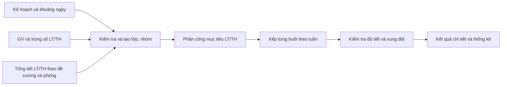

# Kế hoạch thay đổi xếp lịch theo khoảng ngày và trọng số LT/TH

Ngày lập: 30/10/2026. Người dùng đã chốt triển khai giải pháp ba file với tổng tiết LT/TH theo đề cương và trọng số chia lớp giữa các GV. Các mục thiết kế bên dưới là kế hoạch được duyệt; mục 10 ghi nhận triển khai và phạm vi kiểm chứng.

## 1. Kết quả cần đạt

- File kế hoạch mô tả nhu cầu mở lớp và khoảng thời gian được phép học, có tuần bắt đầu và tuần kết thúc kèm ngày/tháng/năm cụ thể.
- Đầu vào không ấn định thứ, tiết bắt đầu hoặc số tiết mỗi buổi/mỗi tuần. Thuật toán quyết định các thông tin này sau khi xếp.
- Một lớp có thể học 2 tiết ở tuần này và 3 tiết ở tuần khác, đồng thời phải hoàn thành đúng khối lượng môn học.
- Giữ số tín chỉ; lấy riêng tổng tiết LT và tổng tiết TH theo đề cương học phần để làm mục tiêu xếp lịch. Tổng tiết học của một sinh viên bằng tiết LT + tiết TH theo cơ cấu đó.
- File giảng viên có hai cột trọng số LT và TH, dùng để phân công riêng lớp lý thuyết và nhóm thực hành.
- Kết quả thể hiện được lịch chi tiết từng tuần, ngày, thứ, tiết, phòng và giảng viên, cùng thống kê phân công.

## 2. Hiện trạng đã kiểm tra

| Thành phần | Hành vi hiện tại | Thay đổi cần làm |
|---|---|---|
| [Giao diện xếp lịch](../frontend/src/AutoSchedulePage.jsx) | Mẫu Excel và nhập tay có tuần bắt đầu dạng số, thứ, tiết bắt đầu, số tiết | Thay đồng bộ mẫu tải về, hướng dẫn và nhập tay bằng khoảng ngày; thêm trọng số ở bảng GV |
| [Đọc Excel](../server/src/main/java/com/service/ExcelScheduleService.java) | Đọc số tiết cố định, chọn một GV bằng vòng luân phiên cho mỗi dòng kế hoạch; tạo yêu cầu 16 tuần | Đọc ngày, giữ đầy đủ ứng viên và trọng số, suy ra phạm vi tuần từ kế hoạch |
| [Thuật toán](../server/src/main/java/com/service/AutoScheduleService.java) | LT lặp số tiết cố định mỗi tuần; TH cùng GV với LT, mỗi tổ có đúng hai buổi cách tuần | Tách phân công LT/TH và lập các buổi học có số tiết thay đổi theo tuần |
| [Nhu cầu môn học](../server/src/main/java/com/dto/CourseDemandDTO.java) | Có tuần bắt đầu và số tiết mỗi buổi, chưa có ngày kết thúc hoặc tổng tiết LT/TH | Bổ sung khoảng ngày, khối lượng và danh tính lớp/nhóm |
| [Ứng viên GV](../server/src/main/java/com/dto/TeacherCandidateDTO.java) | Có mã, tên, số lớp được giao | Bổ sung hai trọng số và phân công theo từng loại |
| [Dòng lịch lưu](../server/src/main/java/com/model/TeachingCourse.java) | Mỗi dòng có một thứ, tiết đầu, số tiết và chuỗi tuần | Dùng nhiều dòng cho các tuần có lịch khác nhau; bổ sung liên kết lớp/nhóm và loại LT/TH nếu cần |
| [Xuất Excel](../frontend/src/scheduleExport.js) | Xuất các đoạn tuần cho từng dòng lịch | Giữ riêng các đoạn khác số tiết/phòng/GV, bổ sung thống kê |
| [Nhập JSON](../frontend/src/jsonSchedule.js) | Nhập lịch cá nhân đã được phân công, yêu cầu thứ/tiết/phòng | Vẫn cần các trường chi tiết của lịch đã xếp; kiểm tra tương thích lịch có nhiều dòng cho cùng môn |

Các nhận định trên dựa vào mã hiện tại. Tài liệu yêu cầu cũ có những đoạn chưa phản ánh chức năng xếp lịch đang có, nên cần cập nhật cùng đợt triển khai.

## 3. Thiết kế đầu vào

### 3.1. File 1: kế hoạch mở lớp

Các cột chính:

| Cột | Ý nghĩa |
|---|---|
| STT | Nhận diện dòng nguồn để báo lỗi |
| Mã môn, Tên học phần | Xác định môn học |
| Sĩ số, Khóa, Số lớp mở | Nhu cầu lớp và số sinh viên |
| Tuần bắt đầu — từ ngày | Ngày cụ thể dạng dd/MM/yyyy |
| Tuần kết thúc — đến ngày | Ngày cụ thể dạng dd/MM/yyyy |
| Số tín chỉ | Bắt buộc; giữ khối lượng tín chỉ của học phần theo đề cương |
| Tổng tiết LT | Đề xuất thêm; số tiết LT phải hoàn thành cho mỗi lớp, lấy theo đề cương |
| Tổng tiết TH | Đề xuất thêm; số tiết TH phải hoàn thành cho mỗi nhóm TH, lấy theo đề cương; ghi 0 nếu môn không có TH |

Không còn cột Tiết BĐ, Số tiết mỗi buổi và Thứ 2…Thứ 7.

Hai cột tổng tiết mô tả khối lượng toàn học phần, không ấn định độ dài một buổi hay số tiết một tuần. Giải pháp giai đoạn đầu vẫn giữ ba file; không bắt buộc thêm file đề cương riêng hoặc xây danh mục môn học trước khi dùng được chức năng.

Đề xuất hiểu hai ngày là giới hạn học thực tế, tính cả hai đầu. Giao diện tính số tuần tương ứng theo mốc Thứ Hai của tuần 1 và hiển thị cả số tuần lẫn khoảng ngày. Không tự mở rộng khoảng cho phép học khi ngày đầu/cuối nằm giữa tuần. Nếu nghiệp vụ yêu cầu luôn bắt đầu Thứ Hai và kết thúc cuối tuần thì bổ sung kiểm tra sau khi chốt.

Đọc được ô ngày Excel thực và chuỗi dd/MM/yyyy; lưu/trao đổi bằng ngày ISO yyyy-MM-dd. Báo lỗi rõ dòng/cột khi ngày không tồn tại, ngày cuối trước ngày đầu hoặc ngoài phạm vi hệ thống hỗ trợ. Giữ mốc tuần chung đang có của GV, không tự đổi mốc làm lệch lịch các trường khác.

### 3.2. Khối lượng theo đề cương — giải pháp đề xuất

Theo thông tin người dùng cung cấp, cơ cấu LT/TH khác nhau giữa các học phần. Ví dụ 3 tín chỉ có thể gồm 2 tín chỉ LT tương ứng 30 tiết và 1 tín chỉ TH tương ứng 30 hoặc 45 tiết theo đề cương. Vì vậy thay cách hiểu trước đây rằng mọi môn đều có tổng tiết bằng số tín chỉ × 15 bằng khối lượng LT/TH được khai báo riêng.

Giai đoạn đầu, người lập kế hoạch nhập hai cột Tổng tiết LT và Tổng tiết TH từ đề cương. Các trường dữ liệu chuẩn hóa gồm credits, theoryPeriods và practicePeriods; chưa cần thêm cột tín chỉ LT/TH nếu thuật toán đã nhận được hai tổng tiết chính xác.

| Ví dụ minh họa từ mô tả người dùng | Tín chỉ | Tổng tiết LT | Tổng tiết TH | Tổng tiết học mỗi sinh viên |
|---|---:|---:|---:|---:|
| Môn chỉ có LT | 3 | 45 | 0 | 45 |
| Môn kết hợp, phương án đề cương A | 3 | 30 | 30 | 60 |
| Môn kết hợp, phương án đề cương B | 3 | 30 | 45 | 75 |

Các hàng trên minh họa cấu trúc dữ liệu, không ấn định cơ cấu cho một môn thực tế cụ thể.

Quy tắc kiểm tra đề xuất:

- Bắt buộc có số tín chỉ hợp lệ và hai tổng tiết là số nguyên không âm; ít nhất một tổng tiết phải dương. Ô trống được báo thiếu, không tự hiểu là 0.
- Môn chỉ có LT ghi TH = 0; chỉ tạo nhóm TH và yêu cầu LAB khi TH > 0. Môn chỉ có TH có thể ghi LT = 0 nếu đúng đề cương.
- Thiếu dữ liệu thì báo lỗi theo dòng/cột. Không mặc định TH thành 15, 30 hoặc 45 tiết; không ép LT + TH bằng tổng tín chỉ × 15.
- Nếu sau này có thêm tín chỉ LT/TH để tra cứu thì kiểm tra tổng tín chỉ thành phần khớp tổng tín chỉ. Chỉ hỗ trợ điền gợi ý tổng tiết khi đã có quy tắc riêng đã xác định của học phần và vẫn cho kiểm tra theo đề cương.
- Các dòng thuộc cùng học phần, khóa và phiên bản đề cương phải thống nhất khối lượng; dữ liệu mâu thuẫn phải được báo trước khi xếp.
- Tổng tiết LT tính cho mỗi lớp; tổng tiết TH tính cho mỗi nhóm TH để mọi sinh viên nhận đủ khối lượng. Khi tách nhóm, mỗi nhóm học đủ phần TH. Tổng tiết GV phải dạy = số lớp LT × tiết LT + tổng số nhóm TH × tiết TH.
- Trọng số LT/TH của GV chỉ dùng chia lớp/nhóm giữa các GV. Hai tổng tiết của học phần quyết định khối lượng học, độc lập với các trọng số này.

Ví dụ lịch linh hoạt: phần LT cần 30 tiết trong 12 tuần có thể gồm 6 tuần × 2 tiết và 6 tuần × 3 tiết. Phần TH được xếp riêng để đủ tổng tiết TH trong những tuần được phép.

Giai đoạn sau có thể tạo danh mục khối lượng học phần theo mã môn, khóa/chương trình và phiên bản đề cương, kèm tham chiếu tài liệu. File kế hoạch tra cứu từ danh mục để giảm nhập lại; mỗi lần xếp vẫn giữ bản chụp khối lượng đã dùng. Đây là hướng mở rộng, không phải điều kiện bắt buộc của giai đoạn đầu.

### 3.3. File 2: giảng viên — môn học — khóa

Giữ các cột Mã môn, Tên học phần, Khóa, Mã GV, Họ tên giảng viên; thêm Trọng số LT và Trọng số TH.

Trọng số gắn với quan hệ GV–môn–khóa, không mặc định là một thuộc tính chung cho mọi môn của GV. Đề xuất dùng số nguyên không âm; giá trị 0 nghĩa là không nhận loại đó. Trọng số không bắt buộc cộng lại thành 10.

Đề xuất bắt buộc đủ hai cột ở mẫu mới. Thiếu cột/ô, giá trị âm hoặc nhiều dòng cùng GV–môn–khóa có trọng số mâu thuẫn phải được báo lỗi. Khi có nhu cầu LT/TH nhưng không có GV có trọng số dương tương ứng thì báo không thể phân công, không tự sinh GV để thay thế.

File phòng giữ cấu trúc hiện có. Danh mục phòng tiếp tục quyết định loại phòng và sức chứa phù hợp.

### 3.4. Cách tổ chức các tuần thực hành

Thuật toán tự phân bổ TH trong khoảng ngày học chung và chia nhóm theo sức chứa LAB thực tế. Lớp 50 SV có LAB 50 chỗ được học chung thành một nhóm; nếu LAB lớn nhất chỉ có 30 chỗ thì chia đều thành hai nhóm 25 SV. Không giới hạn cứng 30 SV/nhóm. Nếu có giới hạn nhóm riêng theo đề cương thì lấy mức nhỏ hơn giữa giới hạn đó và sức chứa LAB. Mỗi nhóm nhận đủ tổng tiết TH theo đề cương. Người lập kế hoạch không phải khai báo thêm các cột cấu hình buổi học hoặc nhóm trong file hay bảng nhập nhanh.

Điều chỉnh theo phản hồi người dùng: file kế hoạch chỉ có 11 cột ở mục 3.1, kết thúc bằng Tổng tiết TH. Sáu cột cấu hình đã tự thêm trước đó được gỡ khỏi mẫu Excel, bảng nhập nhanh và bộ đọc file. Các giới hạn vận hành còn lại là nội bộ thuật toán.

## 4. Phân công theo trọng số

### 4.1. Cách chia lớp giữa các GV — đã được xác nhận

Người dùng đã chọn cách chia lớp giữa các GV như ví dụ. Phân bổ LT theo trọng số LT của các GV đủ điều kiện dạy môn/khóa đó; TH tương tự. Ví dụ có 10 lớp LT và 10 nhóm TH:

| GV | Trọng số LT | Trọng số TH | Mục tiêu LT | Mục tiêu TH |
|---|---:|---:|---:|---:|
| A | 2 | 8 | 2 lớp | 8 nhóm |
| B | 8 | 2 | 8 lớp | 2 nhóm |

Tính mục tiêu bằng tổng số lớp/nhóm của loại đó nhân trọng số GV, chia tổng trọng số của các GV đủ điều kiện. Làm tròn bằng phương pháp phần dư lớn nhất; xử lý hòa theo thứ tự ổn định để kết quả có thể kiểm tra và tái lập.

Đơn vị đếm: một lớp LT là một đơn vị; một nhóm TH là một đơn vị. Một nhóm học nhiều buổi vẫn chỉ là một nhóm được giao, không đếm mỗi buổi thành một lớp mới.

LT và TH của cùng lớp có thể do các GV khác nhau phụ trách. Mỗi lớp/nhóm giữ một GV xuyên suốt đợt học, trừ khi có yêu cầu khác.

### 4.2. Giới hạn cần thể hiện rõ

Trọng số là ưu tiên phân công, phải tuân theo số lớp/nhóm thực tế và lịch khả dụng. Nếu chỉ có một GV đủ điều kiện, hoặc số lớp LT và TH chênh lệch lớn, cách chia tương đối không đảm bảo chính GV đó có đúng cơ cấu 20% LT–80% TH.

Ý nghĩa đã chốt là chia nhu cầu LT và TH giữa các GV theo hai bộ trọng số riêng. Không cần hỏi lại việc chọn cách hiểu trọng số.

Kết quả báo mục tiêu và số giao thực tế riêng cho LT/TH, cùng lý do lệch nếu phải đổi GV do xung đột. Không được bỏ lớp chỉ để đạt tỷ lệ đẹp.

## 5. Lập lịch theo từng tuần

1. Tạo danh tính ổn định cho từng lớp LT và nhóm TH; giữ quan hệ nhóm TH thuộc lớp nào. Tính nhóm theo sĩ số và quy tắc chia nhóm đã cấu hình, kiểm tra sức chứa LAB. Không đồng nhất cả khóa với một lớp sinh viên.
2. Xác định các tuần/ngày hợp lệ trong khoảng của từng dòng kế hoạch; lấy theoryPeriods và practicePeriods theo đề cương, theo dõi số tiết còn thiếu riêng từng loại. LT và TH đều nằm trong khoảng ngày học chung.
3. Phân công theo trọng số rồi tìm các buổi phù hợp; khi bế tắc, xem lại lựa chọn buổi/phòng/GV thay vì dừng ở lựa chọn đầu tiên. Giới hạn phạm vi tìm kiếm để kiểm soát thời gian chạy.
4. Cho phép các tuần có số tiết khác nhau. Ưu tiên phân bố tương đối đều, ít đổi thứ/khung giờ/phòng nếu có thể. Cấu hình số tiết tối thiểu/tối đa mỗi buổi, mỗi tuần và việc có được tách nhiều buổi trong tuần.
5. Kiểm tra xung đột theo ngày và giờ thực tế: GV, phòng, cùng lớp/nhóm sinh viên; so cả lịch đã lưu ở các trường khác của GV. Không vượt khung tiết hay sức chứa.
6. Duy trì quy tắc hiện có về LT/TH khác ngày của cùng GV trong bản đề xuất. Quy tắc TH cách tuần cần biểu diễn thành chính sách rõ ràng; bỏ giả định mọi nhóm luôn chỉ có hai buổi, tính số buổi từ khối lượng và cấu hình đã chốt.
7. Chỉ thành công khi đủ tổng tiết của mọi lớp/nhóm và không vi phạm ràng buộc. Nếu không xếp đủ, trả bản xem trước, số tiết còn thiếu và nguyên nhân; giữ hành vi không ghi đè lịch cũ khi kết quả chưa đầy đủ.

## 6. Lưu dữ liệu và trình bày kết quả

- Bổ sung dữ liệu kế hoạch, khoảng ngày, số tín chỉ, hai tổng tiết theo đề cương và trọng số theo môn/khóa ở mức cần thiết để có thể kiểm tra lại quyết định phân công. Giữ bản chụp khối lượng của lần xếp; không để sửa danh mục sau này làm đổi mục tiêu của lịch đã lưu. Không chỉ thêm hai cột vào hồ sơ GV chung.
- Dòng kết quả có mã lớp/nhóm, loại LT/TH, GV, tuần/ngày, thứ, tiết đầu, số tiết và phòng. Dùng định danh/loại rõ ràng thay cho việc chỉ suy ra TH từ tiền tố tên môn.
- Có thể tái sử dụng chuỗi tuần hiện tại: buổi 2 tiết và buổi 3 tiết của cùng lớp phải là hai dòng riêng, mỗi dòng chỉ đánh dấu những tuần áp dụng. Chỉ gộp khi mọi thuộc tính lịch giống nhau.
- Tổng số lớp/nhóm được đếm theo định danh, tách khỏi tổng số buổi và số dòng kết quả. Lịch thay đổi theo tuần không được làm tăng giả số lớp phân công.
- Bảng lịch kết quả có bộ lọc tuần và khoảng ngày. Theo yêu cầu giản lược giao diện, bỏ hai bảng thống kê trọng số/phân công và khối lượng từng lớp/nhóm; chỉ hiển thị cảnh báo ngắn gọn khi có lỗi hoặc thiếu tiết, kèm tổng số lớp/nhóm và tiết còn thiếu nếu có.
- Xuất Excel có lịch chi tiết theo tuần/đoạn tuần đồng nhất và bảng tổng hợp phân công. Đọc lại file phải giữ nguyên những tuần có số tiết khác nhau.
- Kiểm tra việc cập nhật các GV từng được giao nhưng nay không còn lớp, để lần xếp lại không để sót lịch cũ; kiểm tra phạm vi thay thế theo trường và mốc tuần đang có.

## 7. Thứ tự triển khai

| Bước | Công việc | Kết quả kiểm tra được |
|---|---|---|
| 1 | Thống nhất mẫu có tín chỉ, tổng tiết LT/TH theo đề cương, khoảng ngày và trọng số chia lớp; xác định cấu hình tuần TH | Hợp đồng dữ liệu và ví dụ nghiệp vụ thống nhất |
| 2 | Mở rộng DTO, dữ liệu cần lưu và migration; định nghĩa mẫu mới | Dữ liệu đầu vào/kết quả có khoảng ngày, khối lượng, trọng số, định danh lớp/nhóm |
| 3 | Sửa bộ đọc Excel, mẫu tải về và nhập tay đồng bộ | Báo lỗi ngày/trọng số/khối lượng theo dòng; không đoán các cột cũ |
| 4 | Tách phân công LT/TH và tính chỉ tiêu theo trọng số | Kiểm tra được ví dụ 2–8 và 8–2, số lớp lẻ, trọng số 0 |
| 5 | Xếp từng buổi/tuần, kiểm tra đủ tiết và xung đột | Có lớp học 2 tiết tuần này, 3 tiết tuần khác đúng nhu cầu |
| 6 | Tích hợp lưu, xem tuần, xuất Excel và đọc lại | Lịch hiển thị và dữ liệu lưu/xuất nhất quán |
| 7 | Kiểm thử hồi quy và cập nhật tài liệu | Các tiêu chí nghiệm thu bên dưới đạt |

Luồng ba file dùng hợp đồng mới rõ ràng; file cũ thiếu ngày kết thúc, tổng tiết LT/TH hoặc trọng số được hướng dẫn chuyển đổi, không âm thầm hiểu nhầm cột. Các API nhập lịch đã xếp tiếp tục mang đầy đủ thứ/tiết/phòng.

## 8. Tiêu chí nghiệm thu và kiểm thử trọng tâm

1. Kế hoạch mới không yêu cầu thứ, tiết bắt đầu, số tiết mỗi buổi; ngày bắt đầu/kết thúc hợp lệ và được đọc đúng cả dạng ô ngày Excel lẫn văn bản.
2. Mọi buổi nằm trong khoảng ngày cho phép, kể cả tuần đầu/cuối không đủ tuần; kiểm tra cả khoảng đi qua năm mới.
3. Tổng tiết LT từng lớp và TH từng nhóm đúng dữ liệu theo đề cương, mỗi sinh viên nhận đủ khối lượng. Số tiết thực tế giữa các tuần có thể khác nhau, không thiếu/thừa hoặc đếm trùng. Kiểm tra môn 3 tín có LT/TH = 45/0, 30/30 và 30/45; không bác bỏ hai trường hợp sau do tổng tiết khác 45. Kiểm tra thiếu/sai tín chỉ, tổng tiết âm/trống, cả LT và TH cùng bằng 0; TH = 0 không tạo nhóm hoặc buổi TH.
4. Hai GV có trọng số đối xứng 2–8 và 8–2 được phân công đúng mục tiêu khi tài nguyên cho phép; tổng lớp lẻ được làm tròn hợp lệ, trọng số 0 không nhận loại tương ứng.
5. LT/TH cùng lớp có thể giao hai GV khác nhau; lịch sinh viên, GV và phòng không trùng. Phân công và số nhóm không bị đếm theo số dòng lịch.
6. Không đủ tổng tiết trong khoảng ngày, thiếu GV phù hợp, thiếu LAB hoặc hết giờ phải báo phần còn thiếu và không lưu lịch dở dang.
7. Xem lịch tuần, tải lại sau lưu và xuất/nhập lại Excel đều giữ đúng lịch 2 tiết/3 tiết theo tuần; luồng JSON lịch cá nhân vẫn đọc được nhiều dòng của cùng môn.
8. Xếp lại không để sót lịch cũ của GV đã rút khỏi phân công; không làm lệch mốc tuần hoặc mất lịch trường khác; giữ kiểm thử giao dịch và quyền truy cập hiện có.
9. Mọi buổi TH nằm trong khoảng học chung và mỗi nhóm đủ khối lượng. Thống kê tổng tải GV phải tính đủ các nhóm thay vì chỉ cộng tiết TH một lần cho cả lớp; mẫu kế hoạch tải về chỉ có đúng 11 cột.

Kiểm thử tập trung vào bộ đọc Excel, phân bổ theo trọng số, lịch biến đổi theo tuần, lưu giao dịch và xuất/nhập lại. Điều chỉnh các kiểm thử cũ đang khẳng định luôn có đúng hai buổi TH khi hợp đồng mới đã được chốt.

## 9. Quyết định đã chốt và các điểm còn lại

Đã chốt với người dùng:

1. Giữ số tín chỉ, không ấn định số tiết mỗi buổi. Theo làm rõ mới nhất, LT/TH phụ thuộc đề cương từng học phần; ví dụ 1 tín chỉ TH có thể tương ứng 30–45 tiết. Quy tắc này thay thế giả định trước đó rằng tổng tiết của mọi môn đều bằng tín chỉ × 15.
2. Chia lớp LT và nhóm TH giữa các GV theo trọng số của từng loại, đúng ví dụ 2–8 và 8–2 ở mục 4.1.

Giải pháp đề xuất để dùng được các quy tắc đã làm rõ:

1. Giai đoạn đầu thêm Tổng tiết LT và Tổng tiết TH vào file kế hoạch, lấy trực tiếp từ đề cương; tiếp tục giữ ba file. Giai đoạn sau có thể thêm danh mục học phần để tự điền khối lượng.
2. Việc chia buổi, phân bổ tuần và chia nhóm TH được xử lý nội bộ; không đưa các cột cấu hình này vào file kế hoạch hoặc bảng nhập nhanh. Tiếp tục giữ LT/TH khác ngày của cùng GV như mục 5.

Nguồn khối lượng và ý nghĩa trọng số đã được người dùng làm rõ. Người dùng đã chốt giải pháp thêm hai tổng tiết vào kế hoạch và yêu cầu triển khai.

## 10. Ghi nhận triển khai

- [Bộ đọc mẫu mới](../server/src/main/java/com/service/WeeklyPlanExcelReader.java) đọc tiêu đề cột, ngày Excel/ngày văn bản bốn chữ số năm, tín chỉ, tổng tiết LT/TH và toàn bộ ứng viên GV theo môn/khóa. Thiếu dữ liệu báo lỗi; không tự gán thứ, tiết hoặc tạo GV.
- [Bộ xếp lịch theo tuần](../server/src/main/java/com/service/WeeklyScheduleEngine.java) tạo định danh lớp/nhóm, chia chỉ tiêu theo phần dư lớn nhất trên tổng nhu cầu cùng môn/khóa, thử GV/khung tuần thay thế có giới hạn, kiểm tra đủ tiết và xung đột GV/phòng/sinh viên. Gộp các tuần chỉ khi lớp, GV, phòng, thứ và dải tiết giống nhau.
- Giới hạn nội bộ hiện tại: tối đa 3 tiết mỗi buổi và 6 tiết mỗi tuần; đây không phải số tiết buổi học cố định và không phải dữ liệu người dùng phải nhập. Nhóm TH dựa vào sức chứa LAB lớn nhất của đúng trường trong danh mục được chọn; giới hạn nhóm riêng là tùy chọn, không mặc định 30 SV. Phạm vi tối đa 100 tuần, 5000 lớp/nhóm và 100000 tiết mỗi lần.
- Luồng ba file dùng khoảng học chung cho cả LT/TH; các tuần đầu/cuối luôn tuân theo giới hạn ngày thực tế. Mẫu Excel và bảng nhập nhanh chỉ giữ các dữ liệu kế hoạch ở mục 3.1.
- [Luồng lưu](../server/src/main/java/com/service/ScheduleService.java) thay toàn bộ dòng WEEKLY_AUTO của trường, gồm GV rút khỏi kế hoạch, giữ lịch nhập riêng/trường khác. Mỗi dòng tự xếp lưu định danh, loại buổi và bản chụp khối lượng/khoảng ngày/trọng số. Bản xem trước thiếu tiết không được ghi đè lịch cũ; giao dịch ngoài cũng hoàn tác thay đổi phòng.
- [Migration V3](../server/src/main/resources/db/migration/V3__weekly_planner_metadata.sql) thêm cột theo cách kiểm tra tồn tại để bảo toàn dữ liệu hiện có. Đã áp dụng lên MySQL Docker theo yêu cầu triển khai thử, sau khi sao lưu và đối chiếu số bản ghi; xem phần kiểm chứng bên dưới.
- [Giao diện](../frontend/src/AutoSchedulePage.jsx), [mẫu Excel](../frontend/src/autoScheduleWorkbook.js) và [xuất kết quả](../frontend/src/scheduleExport.js) dùng hợp đồng mới. Có bộ lọc tuần/khoảng ngày; Excel thêm bảng phân công và khối lượng từng lớp/nhóm. Hai bảng thống kê trên giao diện đã được bỏ theo yêu cầu; trường hợp lỗi chỉ hiện cảnh báo đơn giản.
- API một file phân công cũ tiếp tục dùng hợp đồng cũ. Luồng JSON lịch cá nhân tiếp tục nhận các dòng lịch đã xếp; không đổi thứ/tiết/phòng thành dữ liệu kế hoạch.
- Danh mục đề cương tự điền là giai đoạn sau. Thuật toán hiện tại là tìm kiếm có giới hạn, không cam kết tìm ra mọi nghiệm có thể hoặc nghiệm tối ưu toàn cục; nếu chưa xếp đủ sẽ báo khối lượng còn thiếu và giữ lịch cũ.

### Kiểm chứng

- Backend: 97 kiểm thử qua, 10 kiểm thử MySQL/Testcontainers được bỏ qua do chưa bật RUN_MYSQL_TESTS. Bộ kiểm thử chạy với thư mục build riêng để không bị trình biên dịch của IDE ghi đè.
- Có kiểm thử xuyên suốt đọc ba file mới, nhập phòng, phân công/xếp lịch, lưu H2 và tải lại từng tuần: môn 30 tiết LT + 45 tiết TH, chia 2 nhóm, phải lưu và tải lại đúng 120 tiết dạy.
- Frontend: 29 kiểm thử dữ liệu/API, gồm mẫu Excel mới, kiểm tra ngày/khối lượng/trọng số và xuất/đọc lại lịch 2 tiết/3 tiết theo tuần.
- Trình duyệt: 10 ca liên quan xếp lịch qua trên Chromium desktop/mobile; có kiểm tra nội dung Excel gửi từ bảng nhập tay và bộ lọc tuần. API được mock trong các ca trình duyệt; không ghi DB dev.
- Cập nhật triển khai Docker 30/10/2026: đã sao lưu MySQL và áp dụng trực tiếp migration V3 (profile Docker hiện chưa bật Flyway). Đã xác minh đủ các cột loại buổi, định danh lớp/nhóm và bản chụp kế hoạch; số bản ghi trước/sau giữ nguyên: 10 tài khoản GV, 8 trường, 45 dòng lịch, 8 phòng. Các ca Testcontainers riêng vẫn chưa chạy; việc áp dụng migration thực tế không thay thế bộ kiểm thử đó.
- Đã build lại image backend/frontend, tạo lại hai container và kiểm tra cả ba dịch vụ đều healthy. Backend trả health UP; http://localhost:8088/ và bundle xếp lịch mới đều trả HTTP 200, bundle có các trường khoảng ngày và trọng số mới. Số bản ghi MySQL vẫn khớp sau restart.

### Sửa cảnh báo hết giới hạn tìm kiếm trên mẫu mặc định

- Phát hiện bộ xếp lịch quét toàn bộ lịch đã lưu cho mỗi khung thử và dùng một bộ đếm chung. Một lớp dùng hết giới hạn làm các nhóm phía sau không được tìm kiếm tiếp.
- Đã bổ sung [chỉ mục lịch theo tài nguyên/ngày](../server/src/main/java/com/service/WeeklyReservations.java) cho GV, phòng và lớp/nhóm; kiểm tra ngày LT/TH của GV riêng. Các lần thử có cơ chế hoàn tác đồng bộ mọi chỉ mục.
- Đã tách ngân sách tìm kiếm cho từng lớp/nhóm, giữ giới hạn công việc và cải thiện cảnh báo để phân biệt thiếu GV, thiếu phòng phù hợp, xung đột lịch và việc chạm giới hạn tìm kiếm. Không thêm cột hoặc yêu cầu chia nhỏ mẫu mặc định.
- Có ca hồi quy tái hiện trên mã cũ: lịch không liên quan làm các nhóm TH của mẫu 2 lớp bị bỏ qua dù có tài nguyên phù hợp. Có thêm dữ liệu lịch Docker đã ẩn danh và kiểm tra mẫu với cả bộ 4 phòng nhập nhanh lẫn bộ 8 phòng danh mục.
- Đã xác minh bản sửa: toàn bộ backend có 103 ca qua, 10 ca MySQL/Testcontainers chưa bật. Mẫu 2 lớp, 30 tiết LT và 30 tiết TH, với dữ liệu lịch Docker đã ẩn danh đều xếp đủ 6 lớp/nhóm và 180 tiết dạy trên bộ 4 phòng mẫu và bộ 8 phòng danh mục. Ca hồi quy nhiều lịch không liên quan và ca lớp khó chạm giới hạn nhưng lớp sau vẫn được xếp cũng qua.
- Đã kiểm tra hoàn tác chỉ mục, tránh trùng lớp/nhóm, quy tắc LT/TH khác ngày của GV, lịch khác trường và phòng cùng mã khác trường. Đã build backend bằng Java 21 và cập nhật Docker; backend/frontend đều healthy sau khởi động lại. Dữ liệu MySQL thật không được dùng làm nơi chạy các ca hồi quy.

### Điều chỉnh chia nhóm theo sức chứa LAB (31/10/2026)

- Bỏ giới hạn mặc định 30 SV/nhóm. Nhóm TH được tính theo LAB lớn nhất của đúng trường trong danh mục phòng được chọn; không lấy sức chứa phòng LT hoặc LAB của trường khác.
- Lớp 50 SV và LAB 50 chỗ: một nhóm 50 SV. Lớp 50 SV và LAB lớn nhất 30 chỗ: hai nhóm 25 SV. Chia số sinh viên tương đối đều giữa các nhóm; mỗi nhóm vẫn học đủ tổng tiết TH.
- Thuộc tính giới hạn nhóm riêng theo học phần là tùy chọn, mặc định không có. Nếu được cấu hình thì lấy mức nhỏ hơn giữa giới hạn đó và sức chứa LAB; không thêm cột vào mẫu kế hoạch hay bảng nhập nhanh.
- Khi thiếu LAB, báo không có phòng phù hợp; không tự giả định LAB 30 chỗ rồi sinh các nhóm không có cơ sở.
- Kiểm chứng: toàn bộ backend 112 ca qua, 11 ca MySQL/Testcontainers chưa bật. Đã kiểm tra LAB 20/30/50 chỗ, sĩ số lẻ, nhiều loại phòng, giới hạn riêng và lưu H2 khi đổi từ hai nhóm cũ thành một nhóm cả lớp; các dòng nhóm cũ được thay đúng.
- Đã build backend bằng Java 21, cập nhật Docker và xác nhận backend/frontend healthy, trang localhost:8088 trả HTTP 200. Không cần migration cho thay đổi này.
